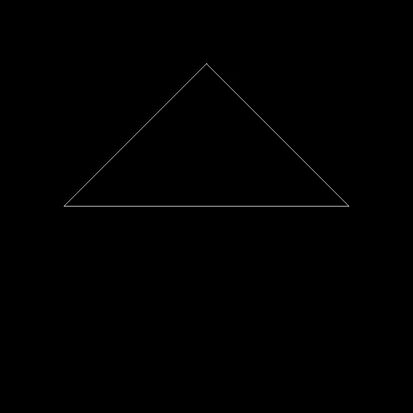
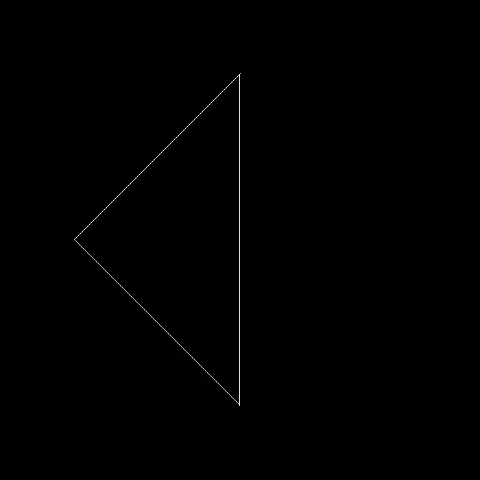
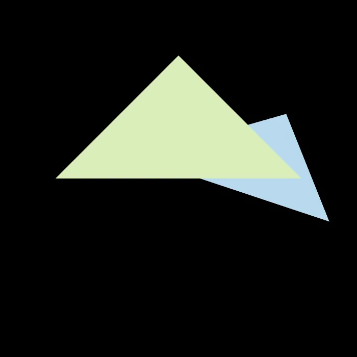
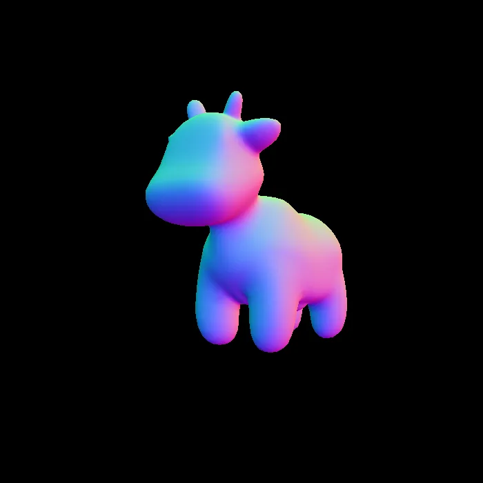
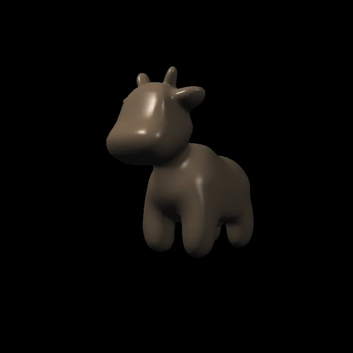
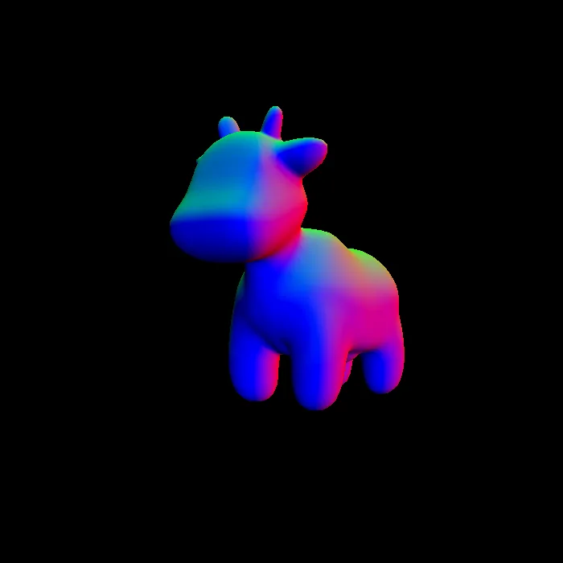
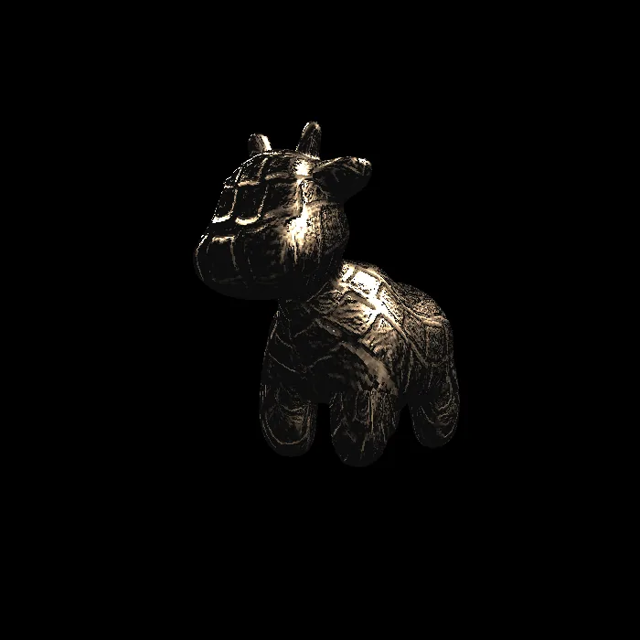
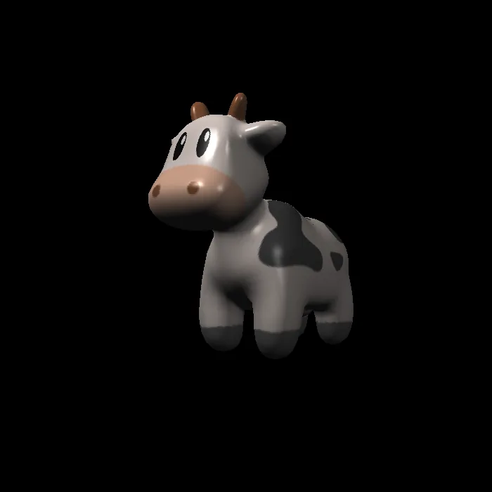

## 1-3次作业总结
```text
第一次作业:理解变换与投影,实现相关矩阵变换的编写
第二次作业:光栅化处理,重点处理三角形的深度遮罩和抗锯齿处理
第三次作业:着色,计算每个像素的颜色,叠加纹理
```

这三次作业合并构成了一个简易的软件渲染器

```text
模型
->模型变换
->视图变换
->投影变换
->光栅化
->属性插值
->Fragment shader
->Z-buffer
->输出图像
```

---
## 作业一:变换与投影

### 目标

使用C++和openCV完成最简易的软件光栅化框架,实现三角形的线框渲染,理解三位顶点如何经过MVP变换进入屏幕空间

### 核心知识
#### 1. 齐次坐标

三维的点和向量都可以用四维齐次坐标表示

```text
点:(x/w,y/w,z/w,w)
向量:(x,y,z,0)
```

#### 2. MVP变换

```text
clip = Projection * View * Model * local
```
Eigen 使用列向量,所以最右边的矩阵先作用;

```text
局部坐标
->Model
->世界坐标
->View
->相机坐标
->Projection
->裁剪空间坐标
```
#### 3. 视图变换

在GAMES101中约定:
```
相机在原点
相机面向-z
相机上方为 + Y
```

```cpp
Eigen::Matrix4f get_view_matrix(Eigen::Vector3f eye_pos)

{

    Eigen::Matrix4f view = Eigen::Matrix4f::Identity();

    Eigen::Matrix4f translate;

    translate << 1, 0, 0, -eye_pos[0], 0, 1, 0, -eye_pos[1], 0, 0, 1,

        -eye_pos[2], 0, 0, 0, 1;

    view = translate * view;

    return view;

}
```
摄像机约定
#### 4.投影变换
```cpp
Eigen::Matrix4f get_projection_matrix(float eye_fov, float aspect_ratio,

                                      float zNear, float zFar)
/*eye_fov(垂直视场角);
aspectratio(宽高比)
zNear(近裁剪平面距离)
zFar(远裁剪平面距离)*/

{
    // Students will implement this function
    Eigen::Matrix4f projection = Eigen::Matrix4f::Identity();
    // TODO: Implement this functio
    // Create the projection matrix for the given parameters.
    
    float n = zNear;
    float f = zFar;
    
    float half_rad = eye_fov * MY_PI / 360.0f;

    float t = std::tan(half_rad) * zNear;
    float r = aspect_ratio * t;

    Eigen::Matrix4f perspective;

    perspective <<   n/r,0,0,0,

                    0,n/t,0,0,

                    0,0,-(f+n) / (f-n), -(2.0f * f * n) / (f-n),

                    0,0,-1,0;

    projection = perspective * projection;
    // Then return it.
    return projection;

}
```
* 该函数用于实现投影变换,其中所写的$$
\mathbf{P} =
\begin{bmatrix}
\frac{n}{r} & 0 & 0 & 0 \\
0 & \frac{n}{t} & 0 & 0 \\
0 & 0 & -\frac{f+n}{f-n} & -\frac{2fn}{f-n} \\
0 & 0 & -1 & 0
\end{bmatrix}
$$
是基于GAMES101的特定相机环境下(相机视锥体沿相机中心对称),基于原透视矩阵$$
\mathbf{P} =
\begin{bmatrix}
\frac{2n}{(r-1)} & 0 & \frac{(r+l)}{(r-l)} & 0 \\
0 & \frac{2n}{t-b} & \frac{t+b}{t-b} & 0 \\
0 & 0 & -\frac{f+n}{f-n} & -\frac{2fn}{f-n} \\
0 & 0 & -1 & 0
\end{bmatrix}
$$
和对称视锥体下的代数特性 $l=-r;b=-t$,进行简化的结果
光栅化#投影变换


#### 5. 罗德里格斯旋转公式

```cpp
Eigen::Matrix4f get_rotation(Eigen::Vector3f axis , float angle){//axis为旋转轴

    axis.normalize();

    Eigen::Matrix4f model = Eigen::Matrix4f::Identity();

    Eigen::Matrix4f rotation;

    float rad = angle * MY_PI / 180.0f;

    float c = std::cos(rad);

    float s = std::sin(rad);

    float x = axis[0];

    float y = axis[1];

    float z = axis[2];


    rotation << c + (1-c)* x*x , (1-c) * x*y -s*z , (1-c)*x*z + s*y, 0,

                (1-c)*x*y + s*z, c + (1-c)*y*y    , (1-c)*y*z - s*x, 0,

                (1-c)*x*z - s*y, (1-c)*y*z + s*x  , c + (1-c)*z*z  , 0,

                0,0,0,1;

    model = rotation * model;


    return model;

}
```
罗德里格斯旋转公式


### 编写途中易错点:

* 透视投影包含了透视挤压和正交投影的处理
* 旋转轴必须为单位向量

### 编译结果




---


## 作业二:光栅化处理三角形


### 目标: 将一个三角形真正填充成像素,并处理多个三角形之间的遮挡关系

### 核心知识

#### 1. 包围盒

* 先求出三角形在xy方向上的最大值和最小值组成的包围矩形,然后只在这个矩形内进行遍历,减少无意义计算

#### 2. 判断点是否在三角形内部

向量(Vectors)
* 核心操作:叉乘
```cpp
static bool insideTriangle(float x, float y, const Vector3f* _v)
{  
    // TODO : Implement this function to check if the point (x, y) is inside the triangle represented by _v[0], _v[1], _v[2]

    Eigen::Vector2f p(x,y);

    Eigen::Vector2f v1(_v[0].x(),_v[0].y());
    Eigen::Vector2f v2(_v[1].x(),_v[1].y());
    Eigen::Vector2f v3(_v[2].x(),_v[2].y());


    float a=cross2D(v1-p,v1-v2);
    float b=cross2D(v2-p,v2-v3);
    float c=cross2D(v3-p,v3-v1);

    bool inside = ((a<=0)&&(b<=0)&&(c<=0))||((a>=0)&&(b>=0)&&(c>=0));

    return inside;//默认三角形边界在三角形内部

}
```

#### 3. 重心坐标

重心坐标
插值(用于平滑过渡) 与 高级纹理

* 重心坐标可以用来插值
	* 深度
	* 颜色
	* 法线
	* 纹理坐标
	* 观察空间位置
 (这些在后续的作业三中会有所体现)

#### 4. Z-buffer

* ***实现思路:*** 将初始深度设置为无穷大,后续再依次读取每个三角形在不同像素下的深度值,如果当前采样的深度更小,就将像素信息进行替换

```cpp
{......
		if (z_interpolated < depth_buf[sample_index])

            {

                depth_buf[sample_index] = z_interpolated;

                sample_color_buf[sample_index] = t.getColor();

                pixel_changed = true;

            }

   }
        if (pixel_changed)

        {

            int base = pixel_index * 4;

  

            Eigen::Vector3f color =

                (sample_color_buf[base + 0] +

                sample_color_buf[base + 1] +

                sample_color_buf[base + 2] +

                sample_color_buf[base + 3]) / 4.0f;

            set_pixel(Eigen::Vector3f(x, y, 0.0f), color);

        }
```

#### 5. MSAA(抗锯齿)

* ***实现思路:*** 对于 2×2MSAA,在一个像素内部采样四个采样点;对每个采样点判断是否在三角形内部,然后对颜色取平均值;还要设置额外的深度缓存,保证深度遮罩的准确性

```cpp
//额外缓存设置

std::vector<Eigen::Vector3f> sample_color_buf;//增加一个颜色采样缓冲,rasterizer.hpp


//rasterizer.cpp
rst::rasterizer::rasterizer(int w, int h) : width(w), height(h)

{

    frame_buf.resize(w * h);

    depth_buf.resize(w * h*4);//额外*4,拓展深度缓存区

    sample_color_buf.resize(w*h*4);//2*2采样,拓展深度缓存和颜色缓存区

}
```

```cpp
//在循环操作前加入像素偏移值,实现在像素内部采样多个点
for(int x=min_x_i ; x<=max_x_i ; x++)

    {

        for(int y=min_y_i ; y<=max_y_i ; y++)

        {

  

            int pixel_index = get_index(x, y);

            bool pixel_changed = false;

  

            for (int s = 0; s < 4; ++s)

            {

                float sample_x = x + sample_offsets[s][0];

                float sample_y = y + sample_offsets[s][1];
                
    ......
```

```cpp
//基于上个深度遮罩操作,如果深度值小,需要更改着色信息

	if (pixel_changed)

            {

                int base = pixel_index * 4;

  

                Eigen::Vector3f color =

                    (sample_color_buf[base + 0] +

                    sample_color_buf[base + 1] +

                    sample_color_buf[base + 2] +

                    sample_color_buf[base + 3]) / 4.0f;

  

                set_pixel(Eigen::Vector3f(x, y, 0.0f), color);

            }
```

### 易错点:

* 包围盒边界需要用ceil函数进行向上取整,否则会漏掉边缘像素
* insideTriangle函数要传入像素中心进行判断,不可使用int整型
* MSAA因为要采样比原先更多的像素,所以在使用MSAA之前,要先拓展缓存区

### 编译结果: 


## 作业三:处理每个像素的颜色着色

### 目标: 将作业二实现的光栅化器升级成带shader的渲染管线,实现:

```text
Phong
Texture
Bump Mapping
Displacement Mapping
```

渲染管线

### 核心知识

#### 1. 图形管线

```text

顶点坐标
->Vertex Shader
->MVP
->光栅化
->属性插值
->Fragment Shader
->Z-buffer
->颜色输出

```

光栅化负责找到像素,Fragment Shader负责决定颜色.
#### 2. Fragment Shader 输入

每个像素需要插值得到:
```text
view_pos----观察空间位置
color-------颜色
normal------法线
tex_coords--纹理坐标
texture-----当前纹理
```


#### 3. Blinn-Phong

环境光只加一次:

```text
result += ka * amb_light_intensity
```

每个光源计算:
```cpp
		Eigen:: Vector3f light_vec = light.position - point;

        float r2 = light_vec.squaredNorm();

        Eigen:: Vector3f l = light_vec.normalized();
        Eigen:: Vector3f v = (eye_pos - point).normalized();
        Eigen:: Vector3f h = (l+v).normalized();


        float n_dot_l = std::max(0.0f,normal.dot(l));
        float n_dot_h = std::max(0.0f,normal.dot(h));


        Eigen:: Vector3f diffuse = kd.cwiseProduct(light.intensity / r2)* n_dot_l;//漫反射

        Eigen:: Vector3f specular = ks.cwiseProduct(light.intensity / r2) * std::pow(n_dot_h,p);//高光

        result_color +=diffuse+specular;

```
Blinn Phong光照模型


#### 4. 纹理映射

纹理映射

根据UV查询纹理:
```cpp
Eigen::Vector3f return_color = {0, 0, 0};
    if (payload.texture)
    {
        // TODO: Get the texture value at the texture coordinates of the current fragment
        return_color = payload.texture->getColor(

            payload.tex_coords.x(),

            payload.tex_coords.y()
        );

    }
```

注意纹理索引边界,将纹理索引限制在有效的范围之内
```cpp
Eigen::Vector3f getColor(float u, float v)

    {

        int u_img = static_cast<int>(u * width);

        int v_img = static_cast<int>((1.0f - v) * height);

  

        u_img = std::max(0, std::min(width - 1, u_img));

        v_img = std::max(0, std::min(height - 1, v_img));

  

        auto color = image_data.at<cv::Vec3b>(v_img, u_img);

        return Eigen::Vector3f(color[0], color[1], color[2]);

    }
```
然后后续就是重复调用之前的Blinn Phong光照模型
```cpp
Eigen::Vector3f texture_color;

    texture_color << return_color.x(), return_color.y(), return_color.z();

    Eigen::Vector3f ka = Eigen::Vector3f(0.005, 0.005, 0.005);
    Eigen::Vector3f kd = texture_color / 255.f;
    Eigen::Vector3f ks = Eigen::Vector3f(0.7937, 0.7937, 0.7937);

    auto l1 = light{{20, 20, 20}, {500, 500, 500}};

    auto l2 = light{{-20, 20, 0}, {500, 500, 500}};

    std::vector<light> lights = {l1, l2};

    Eigen::Vector3f amb_light_intensity{10, 10, 10};
    Eigen::Vector3f eye_pos{0, 0, 10};

  
    float p = 150;

    Eigen::Vector3f color = texture_color;
    Eigen::Vector3f point = payload.view_pos;
    Eigen::Vector3f normal = payload.normal;
    Eigen::Vector3f result_color = {0, 0, 0};
    
    result_color = ka.cwiseProduct(amb_light_intensity);

    for (auto& light : lights)
    {
        // TODO: For each light source in the code, calculate what the *ambient*, *diffuse*, and *specular*

        // components are. Then, accumulate that result on the *result_color* object.

        Eigen:: Vector3f light_vec = light.position - point;

        float r2 = light_vec.squaredNorm();

        Eigen::Vector3f l = light_vec.normalized();

        Eigen::Vector3f v = (eye_pos - point).normalized();

        Eigen::Vector3f h = (l+v).normalized();

        float n_dot_l = std::max(0.0f,normal.dot(l));

        float n_dot_h = std::max(0.0f,normal.dot(h));

        Eigen::Vector3f diffuse = kd.cwiseProduct(light.intensity / r2) * n_dot_l;

        Eigen::Vector3f specular = ks.cwiseProduct(light.intensity / r2) * std::pow(n_dot_h,p);

        result_color += diffuse + specular;
    }
    return result_color * 255.f;
```
#### 5. Bump Mapping

Bump 只扰动法线,不改变几何位置.

构造TBN:

```text
T : 切线
B : 副切线
N : 原法线
```

```cpp
if(payload.texture){

        float x = normal.x();
        float y = normal.y();
        float z = normal.z();


        float denom = std::sqrt(x*x + z*z);

        denom = std::max(denom,1e-6f);

        Eigen::Vector3f t(x*y / denom,denom,z*y/denom);

        t.normalize();


        Eigen::Vector3f b = normal.cross(t);

        b.normalize();

        Eigen::Matrix3f TBN;

        TBN<<

            t.x(),b.x(),normal.x(),

            t.y(),b.y(),normal.y(),

            t.z(),b.z(),normal.z();

        float u = payload.tex_coords.x();
        float v = payload.tex_coords.y();

        float tex_w = static_cast<float> (payload.texture->width);

        float tex_h = static_cast<float> (payload.texture->height);

        float height = payload.texture->getColor(u,v).norm();


        float dU = kh * kn * (payload.texture->getColor(u+1.0f / tex_w,v).norm()-height);

        float dV = kh * kn * (payload.texture->getColor(u,v+1.0f / tex_h).norm()-height);//高度差


        Eigen::Vector3f ln(-dU,-dV,1.0f);//切线空间

        normal = (TBN * ln).normalized();

    }
```

#### 6. Displacement Mapping

* 与Bump前半段相同,但是会移动着色点

```cpp
		point = point + kn * normal * height;

        normal = (TBN * ln).normalized();

```

* 二者的区别在于
	* Bump : normal变了,point不变
	* Displacement: point和normal都改变了

### 易错点

* 法线插值后记得归一化normalized();
* 环境光只叠加一次,不能放在循环内加
* 记得光照的平方衰减
* 纹理采样边界要确定好,预防越界问题
* Bump和Displacement的区别要注意,point和normal的修改
### 编译结果
* normal

* phong

* bump

* Displacement

* texture
