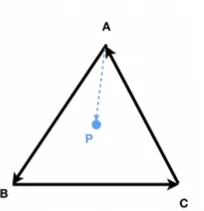
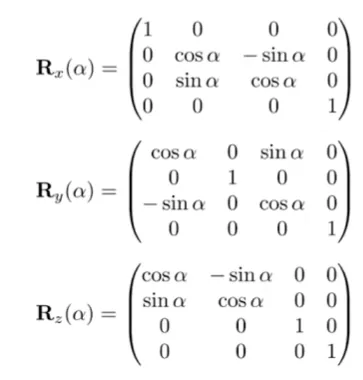
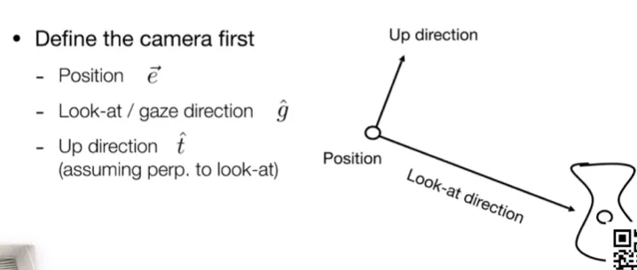
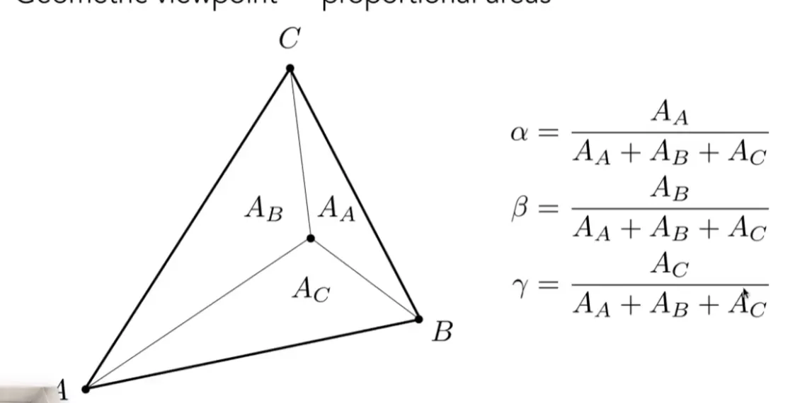
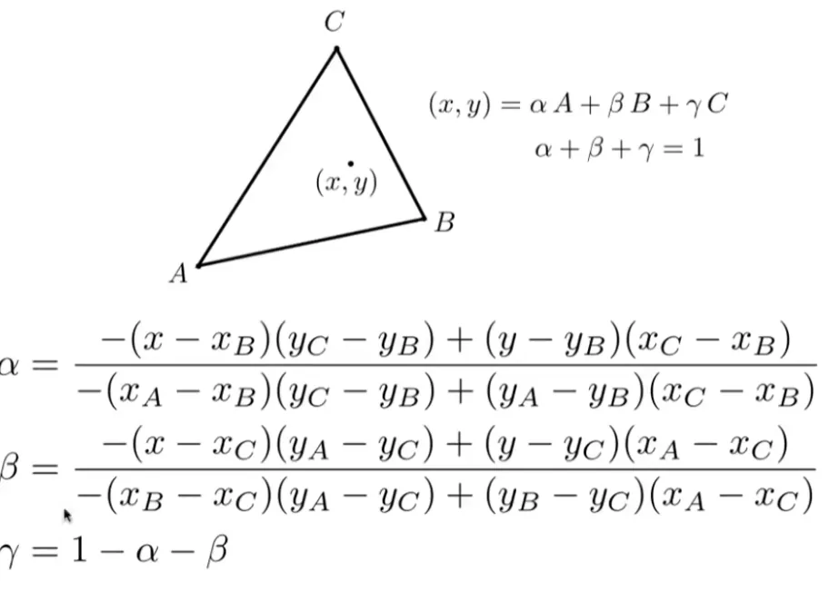

## 线性代数
### 向量(Vectors)
*默认为列向量*

* $\overrightarrow{AB} = \vec{B} - \vec{A}$
* 蕴含了方向和大小信息;
* 负值:大小相同,方向相反
* 基本操作:向量求和;向量求差(相加对应向量的负值)
* 向量求积:点积($\vec{a} \cdot \vec{b}$),叉积($\vec{a} \times \vec{b}$)
	*  点积:$$\vec{a} \cdot \vec{b} = a_1 b_1 + a_2 b_2$$$$\cos\theta = \frac{\vec{a} \cdot \vec{b}}{\|\vec{a}\| \|\vec{b}\|}$$
		* 可以用来反应两个向量的方向相同性(例如兰伯特光照模型),点积的结果是一个数值
		* 也用来使用normalize,初始化向量
		* 或者求一个向量在另一个向量上的投影向量
	* 叉积: $$\mathbf{a} \times \mathbf{b} = \begin{pmatrix} a_yb_z - a_zb_y \\ a_zb_x - a_xb_z \\ a_xb_y - a_yb_x \end{pmatrix}$$
		* 用来求与a,b向量都垂直的向量,叉积的结果是一个向量
		* 结果向量的方向求法:右手螺旋定则
		* 结果的模长:$\vec{a} \times \vec{b} = \|\vec{a}\| \|\vec{b}\| \sin(\theta) \hat{n}$,几何意义表示为以a,b边长的平行四边形面积
		* 作用:
			* 用于判断左和右
				* (一个向量要指向一个点,是顺时针近还是逆时针旋转近)
				* 
				* 如果$\vec{AB}和\vec{AP}叉乘结果,向量指向外侧,那么就说明P点在\vec{AB}的左侧$
			* 判断内和外
				* 基于上述判断左右侧操作,看一个点关于三条边的左右关系
					* 如果都在左边或者都在右边,那么就说明在内侧
		* 关于右手坐标系:如果x,y通过右手螺旋定则求出来+z,那么就是右手坐标系,否则为左手坐标系
* 表现形式
	* 1:$$\vec{v} = \begin{pmatrix} v_1 \\ v_2 \\ v_3 \end{pmatrix}$$
	* 2: $$\mathbf{v} = \begin{bmatrix} v_1 \\ v_2 \\ v_3 \end{bmatrix}$$
* 转置:行列交换:
	* $$\mathbf{x} = [x_1, x_2, x_3]^T=\begin{bmatrix} x_1 \\ x_2 \\ x_3 \end{bmatrix}$$

### 变换矩阵

* 旋转矩阵:$R(\theta) = \begin{bmatrix} \cos\theta & -\sin\theta & 0 \\ \sin\theta & \cos\theta & 0 \\ 0 & 0 & 1 \end{bmatrix}$

* 缩放矩阵:$S(s_x, s_y) = \begin{bmatrix} s_x & 0 & 0 \\ 0 & s_y & 0 \\ 0 & 0 & 1 \end{bmatrix}$
* 平移矩阵:$T(t_x, t_y) = \begin{bmatrix} 1 & 0 & t_x \\ 0 & 1 & t_y \\ 0 & 0 & 1 \end{bmatrix}$
*矩阵变换的顺序极其重要,变换次序之后往往会导致变换结果的改变*


### 罗德里格斯旋转公式

设旋转轴为单位向量 $\vec{n}$，旋转角为 $\theta$，要旋转的向量为 $\vec{v}$，则旋转后的向量是：

$$v_{\text{rot}} = \cos\theta\,v + (1-\cos\theta)(v\cdot n)\,n + \sin\theta\,(n\times v)$$
对应的旋转矩阵形式为:
$$R = I\cos\theta + (1-\cos\theta)\,nn^T + \sin\theta\,N$$
其中 N 是$n=(n_x,n_y,n_z)$的反对称矩阵:
$$N = \begin{bmatrix} 0 & -n_z & n_y \\ n_z & 0 & -n_x \\ -n_y & n_x & 0 \end{bmatrix}$$
即, $N v = n \times v$

##### 该公式的核心思想:先隔离,后整体:

* 先将向量v拆解成平行于n的$v_{\parallel}$  与 垂直于n的 $v_{\perp}$两部分;
* 那么显然,旋转只作用于$v_{\perp}$,那么我们就先考虑垂直于n的这个平面
* 该平面显然存在两个正交方向: $v_{\perp}$ 和 $n\times v$ ;
* 所以：$$n\times v=n\times v_{\perp}$$
* 于是旋转后的垂直分量可以写成：$$v_{\perp,\text{rot}} = \cos\theta\,v_{\perp} + \sin\theta\,(n\times v)$$
* 把平行部分和旋转后的垂直部分加回去：$$v_{\text{rot}} = (v\cdot n)n + \cos\theta\big(v-(v\cdot n)n\big) + \sin\theta\,(n\times v)$$
* 整理后就得到：$$v_{\text{rot}} = \cos\theta\,v + (1-\cos\theta)(v\cdot n)n + \sin\theta\,(n\times v)$$
## 视图变换
### 摄像机约定



规定三个方向来确定一个摄像机的位置
* 位置 $\vec {e}$
* 相机面朝方向 $\vec{g}$
* 相机头顶方向 $\vec{t}$

## 投影变换
### 正交变换

* $M_1 = \begin{bmatrix} 1 & 0 & 0 & -(r+l)/2 \\ 0 & 1 & 0 & -(t+b)/2 \\ 0 & 0 & 1 & -(n+f)/2 \\ 0 & 0 & 0 & 1 \end{bmatrix}$ ***将物体移动到原点***

* $M_2 = \begin{bmatrix} 2/(r-l) & 0 & 0 & 0 \\ 0 & 2/(t-b) & 0 & 0 \\ 0 & 0 & 2/(n-f) & 0 \\ 0 & 0 & 0 & 1 \end{bmatrix}$ ***将物体拉伸为立方体

### 透视变换

* $M_3 = \begin{bmatrix} n & 0 & 0 & 0 \\ 0 & n & 0 & 0 \\ 0 & 0 & n+f & -nf \\ 0 & 0 & 1 & 0 \end{bmatrix}$ ***将物体的xy按照z相对于n的关系进行缩放

* ***整合后的投影变换矩阵:
$M_3 = \begin{bmatrix} n/r & 0 & 0 & 0 \\ 0 & n/t & 0 & 0 \\ 0 & 0 & -(n+f)/(f-n) & -(2.0f * f * n)/(f-n) \\ 0 & 0 & -1 & 0 \end{bmatrix}$ 
(注意: 因为默认摄像机朝向为-z,但一般获取的数据是摄像机距离物体的距离,所以最后一行为(0,0,-1,0),对z轴方向做一次取正操作);

## 着色

### 渲染管线

* **管线是什么:** 从一系列顶点到生成出图片的,中间一系列操作
* 顶点着色器->图元装配与裁剪->光栅化->片段着色器->深度测试->帧缓冲区操作(这一系列操作都在GPU内部写好了)
* **着色的关键步骤**: 顶点处理(ground模型),像素处理(phone模型)
* **顶点着色一般负责什么:** 
	* **MVP变换**
	* **法线变换**
	* **传递UV,颜色,观察空间位置**
* **片段着色器一般负责什么:**
	* **接受插值后的属性**
	* **查询纹理**
	* **计算Blinn-Phong**
	* **输出最终像素颜色**

### Blinn Phong光照模型

***最终颜色 = 环境光 + 所有光源的漫反射 + 所有光源的高光***

* ***四个关键方向:***
	* normal(n):表面法线
	* light_vec(l):当前点到光源的方向
	* view(v): 当前点到相机的方向
	* half(h): 光源方向与观察方向的半程向量
* ***漫反射计算***:
	* $Diffuse = kd * (light.intensity / r2) * max(0,n \cdot l)$
	* $r2 = squaredNorm(light.position - point)$
* ***高光计算:***
	* $Specular = ks * (light.intensity / r2) * pow(max(0,n \cdot h),h)$
	* ks 为高光系数,p为高光指数
		* p越大,高光越集中,越小
		* p越小,高光越分散
		* 高光与观察方向有关
* ***"Blinn Phong" 与 "Phong"的区别***
	* "Blinn Phong"模型 使用半程向量(h)
	* 而"Phong" 模型用的是 $v \cdot reflect(l,n)$

### 着色器(shader)

* **shader:** 用来控制顶点/像素如何着色;
* **相关编写** 
	* ***shader语言***: GLSL,HLSL......
	* (不需要for循环遍历所有像素,只需要考虑一个顶点/像素如何着色即可)
### 引擎
* Unreal,Unity......(内置了大量图形学模板的游戏制作工具)

### GPU

* ***渲染管线的硬件实现***
* ***强大的并行计算能力*** 

### 贴图

#### 纹理映射

* **纹理映射基础**
	* (u,v)坐标
		* 查询纹理
		* 得到颜色或其他表面属性

* **是什么:** 给一个物体贴上一张图(纹理贴图)

* 四边无缝纹理贴图(沿四边循环不会有裂缝)
* 通过特定算法生成

---
	**** 因此,后续考虑的就是,一个像素在采样对应的纹理贴图上会遇到的问题与解决方案***

### 插值(用于平滑过渡) 与 高级纹理

#### 重心坐标

* **引用目的**: 完成三角形内的插值
* ***是什么:*** 三角形所在平面内任意一点,都可以用三个顶点的线性组合得到;$$(x,y) = \alpha A +\beta B + γ C $$$$\alpha + \beta +γ=1$$
	* 在这情况下,只要满足$\alpha >0 ;\beta > 0 ; γ > 0$的点,就在三角形内部;
	* ***例举***: A点所在的重心坐标就是(1,0,0); B点所在的重心坐标就是(0,1,0) ; C点所在的重心坐标就是(0,0,1);
* ***如何计算三个系数***
	* 我们将顶点和目标点链接起来会发现三角形被分割为了若干小三角形
	 根据每个三角形的面积关系就可以求出三个系数的具体数值了;
* ***特殊点:*** (重心)
	* 重心将大三角形分成了三个等面积的小三角形(1/3,1/3,1/3);
* ***简化求系数公式***:
	* 

* **这可以来插值什么?**
	* 颜色
	* 法线
	* 纹理坐标
	* 深度
	* 观察空间位置
#### Mipmap
* **特点**: 
	* 允许做范围查询
	* 仅允许做正方形的范围查询
	* 快,但不准 
#### 各向异性过滤
* ***什么是各向异性:*** 每个方向的特性不同
* ***什么是各向异性过滤:*** 
	* 将纹理贴图在MipMap的做法(也就是长宽整体缩减的同时),再进行额外的单方向压缩,之后在像素着色的时候,将每个像素额外检索这些新的压缩贴图
	* **相比于Mipmap有什么优点**
		* Mipmap只能查询正方形的纹理范围,而各向异性这样单方向压缩后,就能实现矩形(长方形)的范围查询,在某些特定角度下会查询得更加准确
	* **缺点:**
		* Mipmap的额外开销是原本的1/3
		* 而各向异性过滤的最大额外开销是原本的3倍(各向异性的倍数越高[各方向的压缩贴图越多,例如2x是2*2的额外贴图,4x是3*3......],开销越接近3倍,这个倍数几乎不影响原先的性能开销变化)

#### MVP矩阵
* ***是什么***
	* M->模型矩阵
	* V->视图矩阵
	* P->投影矩阵
	* MVP矩阵就是这三个矩阵的合称
* ***完整的变换链***
	* 模型坐标
	* Model
	* 世界坐标
	* View
	* 相机坐标
	* Projection
	* 裁剪空间坐标
	* 透视除法
	* NDC
	* 视口变换
	* 屏幕坐标
```
Eigen::Matrix4f mvp = projection * view * model;

Eigen::Vector4f clip_pos = mvp * to_vec4(local_pos, 1.0f);
```
1. Model:模型矩阵
	* 平移,旋转,缩放
	* 对模型进行上述变换
2. View:视图矩阵
	* 把整个世界变换到相机坐标系,令相机在原点
3. Projection:投影矩阵
	* 正交投影+透视投影
	* 把相机看到的三维场景投影到二维平面上
___
**易混淆知识点:**
>Blinn-Phong : 光照模型
>Phong shading : 逐像素着色方式
>Barycentric : 插值工具
>Texture Mapping : 属性查询
>Mipmap : 纹理过滤
>Bump / Normal / Displacement : 表面细节技术 

# 光线追踪


# 曲线和网络


# 模拟或动画


