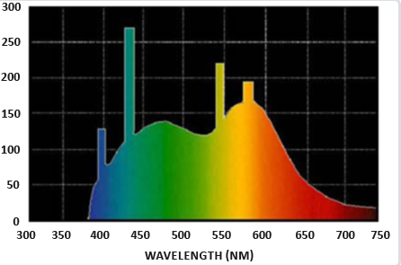
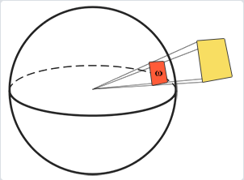
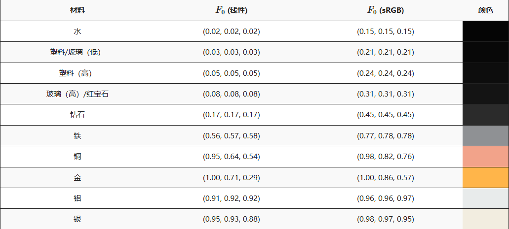

# 光照模型

## 兰伯特模型

用物体法线和光照方向的余弦值来间接表示该点收到的光照强度

$$LamBert = normalize(N) \cdot normalize(L);$$
### 进阶--半兰伯特模型

因为正常的兰伯特模型的数值范围在[-1,1],所以就会导致物体的阴影面出现大片的死黑
半兰伯特模型就是对其进行钳制,限制在了[0,1],让背光面不会一点光照都不接收

$$Half\_Lam = LamBert * 0.5 + 0.5$$


## Rim边缘光

在视图中的物体边缘添加阴影遮罩或者高光遮罩;一般可用于皮肤/丝袜/或者衣服上的材质制作

$$ Rim \_ Mask = normalize(Camera\_Vector) \cdot normalize(Vertex\_Vector)$$
将摄像机朝向和物体表面法线进行点乘,类似兰伯特;

## 


# 常见的PBR效果

* ***一些有关PBR理论知识的文献翻译***
* https://learnopengl-cn.github.io/07%20PBR/01%20Theory/ (理论)
* https://learnopengl-cn.github.io/07%20PBR/02%20Lighting/ (光照)

## 有关PBR的相关理论

***1. 怎样的着色才叫做PBR(基于物理的着色)***
* 基于微平面的表面模型
* 能量守恒
* 应用基于物理的BRDF

***2. 迪士尼原则***
* 通过特定的参数来调整美术效果(金属度,粗糙度......)

### 微平面模型

***微平面理论***
* 该理论认为,**达到微观尺度之后,任何平面都可以用被称为微平面的细小镜面来进行描绘**
* 根据平面的粗糙程度不同,这些细小镜面的取向排列可以相当的不一致
* 假设参数:**粗糙度**
	* 粗糙度越低,高光越集中,锐利
	* 相关计算向量:**半程向量**

### 能量守恒

**什么能量?***:
* 入射光线能量和出射光线能量(大致表现为光照亮度)
***次表面散射***
* 光线照到物体表面后会细分出反射和折射两个部分
* 一般PBR会认为折射光会被表面下的粒子吸收,或碰撞至能量耗尽
* *但次表面散射着色器则考虑了折射中未被吸收而发散出的这部分能量*
* ***优缺点***
	* 优:显著提升了皮肤,蜡质这样的材质视觉效果
	* 缺:性能下降
***金属***
* 金属的折射光线会被直接吸收,不会发散
* 只反射镜反射颜色,不反射漫反射颜色

***镜反射系数与漫反射系数***
```hlsl
float kS = calculateSpecularComponent(...); //反射/镜面
float kD = 1.0f - ks;                       //折射/漫反射
``` 
* 反射与折射在能量层面**互斥**
* *计算出镜面反射部分,它的值为入射光线被反射的能量所占的百分比*
* 然后就能借此算出折射部分了

### 反射率方程

$$ L_o (p,\omega _o) = \int_{\Omega} f_r(p,\omega_i,\omega_o)L_i(p,\omega_i)n \cdot \omega_i d\omega_i $$
#### 辐射率方程
* **辐射率(L)**
	* 有关反射率方程的辐射度量
* **辐射通量$\Phi$**
	* 表示一个光源所输出的能量(单位:**瓦特(W)**)
	* 下图表示日光中不同频率波具有的能量
	
	* 辐射通量会计算出由不同波长构成的函数总面积
		* 在计算时,我们会用**RGB**来替代波长强度
* **立体角$\omega$**
	* 投射到单位球体上的一个截面的大小或面积,而这部分面积就被称为***立体角***
	 
* **辐射强度**
	* 单位球面上,一个光源向每单位立体角所投送的辐射通量
	 $$I =\frac {d \Phi} {d \omega}$$
	* $$L = \frac {d^{2}\Phi} {dAd\omega cos\theta} $$
*其中,$cos \theta =LightDir \cdot N$ 

有趣的是,辐射率方程涵盖了$\omega$和A等我们感兴趣的物理量,那么如果我们控制$\omega和A$为**无穷小**,那么我们就可以用辐射率来表示一个光束穿过空间中一个点的通量

现在,我们回过来继续看反射率方程$$ L_o (p,\omega _o) = \int_{\Omega} f_r(p,\omega_i,\omega_o)L_i(p,\omega_i)n \cdot \omega_i d\omega_i $$
* 我们知道了$L_i(p,\omega_i)$表示的是,通过这个立体角$\omega_i$在某个点上的辐射率,当立体角无穷小时,那么这个立体角也就可视作为入射方向向量了
* 对于原本的,我们来计算能量的余弦方法,在这里自然而然地就转换为了$n\cdot\omega_i$,
* 因为反射率方程考虑的是物体周围入射辐射率的总和,那么我们自然就需要对一个半球领域$\Omega中的所有\omega_i$进行整合,也就是积分;
	* 而这个半球领域$\Omega$可以描述为以平面发现n为轴所绕出的半个球体
	* 而这个积分的方式,我们通过黎曼和来离散求解,用代码粗略表示如下
```hlsl
int steps = 100;                 //离散步数
float sum = 0.0f;                //黎曼和结果
float3 p;                        //point点坐标
float3 W0                        //W0起始立体角
float3 N;                        //N物体法线
float dW = 1.0f / steps;         //离散步长
for(int i = 0;i < steps ;++i){
	float3 Wi = LightDir(i);
	sum += Fr(p,Wi,W0) * Li(p,Wi) * dot(N,Wi) * dW;
}
```


目前为止,关于反射率方程,我们就只剩下***fr函数***了,或者说叫**双向反射分布函数**;

#### 双向反射分布函数

***接收参数***
* 入射光方向$\omega_i$
* 出射方向(观察方向)$\omega_0$
* 平面法线$n$
* 粗糙度$\alpha$
*BRDF函数需要严格遵守能量守恒定律,所以Blinn-Phong模型并不算BRDF函数,即使他也接收$\omega_i和\omega_0$作为参数*

##### Cook-Torrance BRDF模型

$$f_r = k_df_{lambert} + k_s f{cook-torrance}$$
* $k_d(k_diffuse)$,也就是入射光线中,折射部分的能量占比
* $k_s$,就是反射部分的能量占比了
* $f_{lambert}$,***Lambertian漫反射模型***
	* $$f_{lambert} = \frac {c}{\pi}$$
		* c为表面颜色
		* 除以$\pi$是为了对漫反射光进行标准化
		* 和原先的余弦值加表面颜色相比,此处的余弦值放在了公式末端的$n \cdot \omega_i$ 
* $f_{cook-torrance}$ 镜面反射
	* $$f_{cook-torrance} = \frac{DFG}{4(\omega_0\cdot n)(\omega_i \cdot n)}$$
	* ***DFG分别代表什么***
		* **D:法线分布函数:** 用来估算微平面的主要函数
		* **G:几何函数:** 描述了微平面自成阴影属性
		* **F:菲涅尔方程:** 描述不同表面角下表面所反射的光线占比

***法线分布函数(D)----Trowbridge-Reitz GGX***
$$NDF_{GGXTR}(n,h,\alpha) = \frac{\alpha^2}{\pi((n\cdot h)^2(\alpha^2 -1)+1)^2}=\frac{\alpha^2}{\pi((n\cdot h*\alpha^2 -n\cdot h )*n \cdot h +1.0)^2}$$
*其中第二个式子在乘法次数上进行了优化,从原先分子的七次乘法优化到了五次*
以下是代码实现
```hlsl
float a2 = alpha * alpha;
float d = (ndoth * a2 - ndoth)*ndoth + 1.0f;

float GGX = a2 / (PI * d * d);
```
---
***几何函数(G)----Schlick-GGX***
*该函数采用一个材料的粗糙度参数作为输入参数,粗糙度较高的表面其微平面间相互遮蔽的概率就越高*

$$G_{SchlickGGX}(n,v,k)=\frac{n\cdot v}{(n\cdot v)(1-k)+k}$$
其中的k表示$\alpha$的重映射,其取决于我们要使用的是针对**直接光照**还是针对**IBL光照(基于图像照明)** 的几何函数:
$$k_{direct}=\frac{(\alpha+1)^2}{8}$$
$$k_{IBL}=\frac {\alpha^2}{2}$$

为了有效的估算几何部分,需要将*观察方向(几何遮蔽)* 和*光线方向向量(几何阴影)* 都考虑进去,使用的方法则是**史密斯法:**
$$G(n,v,l,k)=G_{sub}(n,v,k)G_{sub}(n,l,k)$$
*几何函数是一个值域为[0.0, 1.0]的乘数，其中1.0表示没有微平面阴影，而0.0则表示微平面彻底被遮蔽。*

```hlsl
float GeometrySchlickGGX(float NdotV,float k)
{
	float nom = NdotV;
	float denom = NdotV * (1.0f - k)+k;
	
	return nom/denom;
}//计算GGX

float GeometrySmith(float3 N,float3 V,float3 L,float k)
{
	float NdotV = dot(N,V);
	float NdotL = dot(N,L);
	float ggx1 = GeometrySchlickGGX(NdotV,k);
	float ggx2 = GeometrySchlickGGX(NdotL,k);
	
	return ggx1 * ggx2;
}//史密斯法引入V(观察方向)和L(光线方向)
```

*此处几何函数公式有点乱,进行如下整理*
$$G = \frac{n \cdot l}{lerp(n \cdot l,1,k)} × \frac{n \cdot v}{lerp(n \cdot v,1,k)}$$
其中,直接光照时$k=\frac{(\alpha+1)^2}{8}$;间接光照(IBL)时,$k=\frac{alpha^2}{2}$


***菲涅尔方程(F)---Fresnel-Schlick近似求解***

菲涅尔方程描述的是反射光和折射光的比率,该比率会随着观察角度的变化而变化

当垂直观察的时候会有一个**基础反射率**,随着我们的视角越来越偏移法线时,所有的反光面都会变得更明显;理论上,如果我们从垂直于法线的角度观察,那么高光会变得特别明显.

$$F_{Schlick}(h,v,F_0)=F_0+(1-F_0)(1-(h\cdot v))^5$$
* **$F_0$** 表示平面的基础反射率,这是靠**折射指数**来计算得出的,常见的 **$F_0$** 数值如下表所示


可以看到,这部分中差异最大的两部分是**非金属与金属**;我们专注看金属部分,会有以下特点
* ***金属***的基础反射率一般是带有颜色的,这就是为什么$F_0$要用RGB来表示
* 电介质表面的基础反射率都不会高于0.17

借此,由金属的独特性表现,我们引出了***金属度***的概念
>理论上来看,金属度应该是一个非1即0的数,一个物质要么是金属,要么是非金属;但我们法线,通过对一些小的非金属类粒子的金属度,能实现一些非常好看的视觉效果

```hlsl
//Frensnel Schlick近似
float cosTheta;
float3 F0;

return F0+(1.0f - F0) * pow(1.0f - cosTheta,5.0);
```

---

至此,我们回过来看***Cook-Torrance反射率方程***
$$ L_o (p,\omega _o) = \int_{\Omega} (k_d\frac{c}{\pi} + k_s \frac{DFG}{4(ViewDir \cdot Normal)(LightDir \cdot Normal)})L_i(p,\omega_i)n \cdot \omega_i  d\omega_i $$

有关分母部分的$4(ViewDir \cdot Normal)(LightDir \cdot Normal)$ ,大致理解成一种配平系数就好,其中两个点乘系数和微平面有关


### PBR材质基础参数

* ***反射率***
* ***法线***:通过法线贴图实现部分表面凹凸纹理
* ***金属度***
* ***粗糙度***
* ***AO:*** 环境光遮蔽


# NPR材质

***什么是NPR渲染***
* 风格化渲染

### 如何实现NPR
*一些基础的实现方式*
* **简化阴影**:常见表现为二分阴影
	* *兰伯特光照模型*
	* *Ramp贴图定义光照颜色*
* **法线修正**:平滑法线
	* 法线修正工具
	* 球形法线映射
	* SDF贴图
* **描边**
	* 贴图内描边
	* 多通道渲染,复制一份更大的模型,剔除正面沿法线方向位移
	* 后处理深度检测描边
	* 设置菲涅尔颜色和范围实现描边
* **高光边缘光处理**
	* Kaijiya-kay
	* Marschner
	* 菲涅尔获取Rim_Mask
