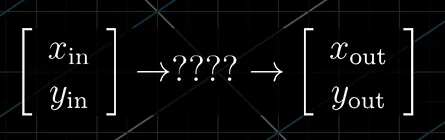
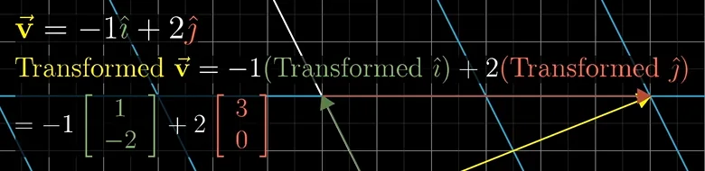

## 认识向量

* **物理上的定义**: 一条有向线段;
* **数学上的定义**: 以起点为原点,指代线段终点的数值;
* **计算机上的定义**: 数组,用于在一个数中存放多种数据类型

### 向量运算

#### 向量加法

向量本质上可以认为是一种运动,代表了*一个点从向量起点到终点的移动;*,那么向量加法可以理解为是两次运动结果的结合

#### 向量与标量的乘法

起点不变,终点在向量方向上对应于标量的缩放;负数代表反向

## 线性组合,张成的空间与基

* x方向的基: $\hat i$
* y方向的基:$\hat j$
* z方向的基:$\hat k$
#### 线性
* **线性组合**: 两个向量在任意标量下相加的结果,$a\hat i+b\hat j$
* **张成空间**: 两个向量$\hat v 与 \hat w$的全部线性组合结果的集合
* **线性相关**: 如果一组向量中,任意删除一个向量的情况下不会减小张成空间,那么它们就是线性相关的(或,一个向量可以表示为其他向量的线性组合)
****

**向量空间中的一组基,是张成该空间中的一个线性无关向量集**

## 矩阵与线性变换

* **变换**: 与函数类似,将一个输入变为一个特定的输出结果
* **线性变换**: 保持空间网格平行且等距分布的变换(即,不弯曲,不移动原点)
***
### 如何用一个数值来表示一个变换

**只需要记录变换后的基向量坐标即可**

对于原本的坐标系,初始基向量为(0,1)和(1,0);在该坐标系下的某一坐标$\hat a=(x,y)$;

换个角度理解一下,该向量的原始坐标其实是关于基向量的两个标量集合;
例如(2,3)表示2个(1,0)和3个(0,1)相加和;
那我们要普适性的用数值标定一个线性变换,只需要找到变换后的基向量就好了,因为我们要求的坐标变换结果,就是该向量与基向量的乘积;

而这个变换后的基向量如何表示,就要引入一个概念了---**矩阵**;

**一个矩阵代表一个线性变换**

